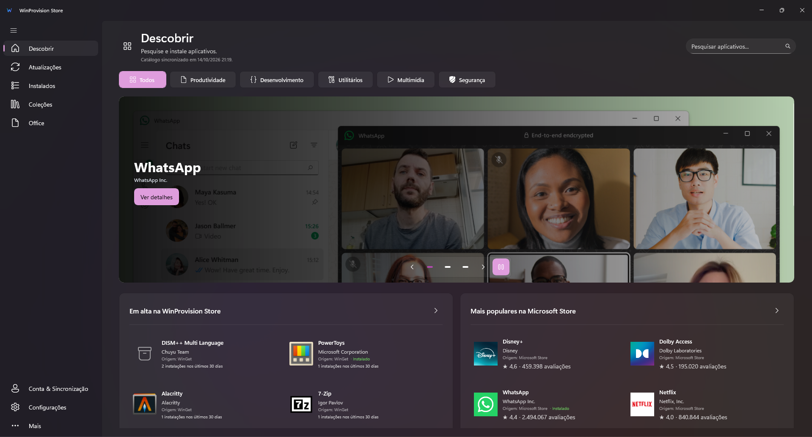

# WinProvision Store

Aplicativo para Windows que reúne pesquisa de aplicativos, instalações, atualizações, programas instalados, coleções, configuração do Office e uma interface de linha de comando.

Conheça o aplicativo no [site do WinProvision Store](https://winprovision-services.github.io/WinProvision-Store/).

O WinProvision Store foi desenvolvido com auxílio de inteligência artificial e pode conter erros. Se encontrar algum problema, relate-o nas [issues do projeto](https://github.com/winprovision-services/WinProvision-Store/issues).



Veja mais telas do aplicativo na [galeria de capturas](docs/SCREENSHOTS.md).

## Instalação

Enquanto a publicação no WinGet está pendente, instale a versão mais recente para Windows x64 pelo PowerShell:

```powershell
$p="$env:TEMP\WinProvision-Setup.exe"; curl.exe -fL --retry 3 -o $p https://github.com/winprovision-services/WinProvision-Store/releases/latest/download/WinProvision.Store-Setup.exe; if($LASTEXITCODE -eq 0){Start-Process $p -Wait -ArgumentList '/VERYSILENT /SUPPRESSMSGBOXES /NORESTART /SP- /MERGETASKS="clipath,desktopicon"'}
```

O instalador usa escopo de máquina e adiciona a CLI ao PATH do sistema por padrão; exige privilégios administrativos e pode ser executado por SYSTEM. O comando baixa o instalador oficial do GitHub e instala silenciosamente, sem reiniciar o Windows, com atalho na área de trabalho e a CLI no PATH. Esta forma curta não confere o SHA-256. Para baixar manualmente o instalador, a versão portátil ou os hashes, consulte as [releases](https://github.com/winprovision-services/WinProvision-Store/releases/latest).

Após a instalação, abra outro terminal para carregar o PATH atualizado:

```powershell
winprovision --version
```

## Recursos

- Pesquise aplicativos por nome e consulte seus detalhes.
- Pesquise também a origem Microsoft Store pelo WinGet; a Display Catalog fornece os metadados e URLs de ícones e banners em tempo real, sem publicar arquivos de mídia da Store no R2.
- Instale, atualize e remova aplicativos, acompanhando o resultado das operações.
- Nas opções de instalação de pacotes WinGet, as versões publicadas pela CDN aparecem automaticamente. O escopo por usuário ou máquina depende dos instaladores da versão selecionada. A verificação de hash pode ser ignorada explicitamente no fluxo WinGet para uma operação, com menor segurança; permanece ativa por padrão.
- Escolha **WinGet-Pkgs + Viper** como método preferencial para usar o detalhe da versão publicado na CDN, conferir seu SHA-256, baixar com Viper, conferir o instalador e instalar silenciosamente quando o formato for compatível. Se a URL estável do fornecedor já entregar outro binário, a operação informa que o catálogo está temporariamente desatualizado e pode ser tentada novamente após a sincronização seguinte.
- Organize listas de aplicativos em coleções e prepare arquivos para uso offline.
- Configure os aplicativos do Office e escolha instalação online ou mídia offline com download pelo ODT ou pelo WinProvision Viper.
- Exporte e importe listas JSON pela CLI.
- Conecte sua conta GitHub, opcionalmente, para sincronizar coleções, escolher qual JSON do Gist importar e gerenciar esses arquivos.
- Use os temas claro e escuro e a navegação por teclado.
- Agende verificações e atualizações pela CLI, em intervalos fixos ou agendas diária/semanal, com execução imediata e notificações do Windows em **Configurações → Manutenção agendada**.
- Escolha notificações por categoria e configure limites simultâneos, pasta padrão e nomes dos instaladores em **Configurações → Notificações** e **Operações e downloads**.
- Consulte o espaço ocupado por imagens, catálogo e instaladores em **Configurações → Armazenamento e cache**. Libere memória, limpe imagens, catálogo ou instaladores reutilizáveis separadamente e ajuste o limite e a revalidação das imagens. Coleções e preferências são preservadas nessas limpezas; veja [cache local](docs/ARCHITECTURE.md#cache-do-catálogo).

Instaladores podem solicitar autorização administrativa ou interação adicional. A disponibilidade de aplicativos depende das fontes consultadas. A preparação de mídia offline exige conexão durante o download.

## Linha de comando

O [WinProvision Viper](src/WinProvision.Viper/README.md) é um módulo HTTP(S) experimental e independente, com biblioteca e executável próprios para downloads segmentados e simultâneos. A biblioteca atende os downloads verificados de instaladores do catálogo, inclusive nas instalações pela API própria; o executável `winprovision-viper.exe` continua separado da CLI `winprovision`.

```powershell
winprovision search Chrome
winprovision install --id Google.Chrome
winprovision upgrade --all
winprovision export --output apps.json
winprovision import apps.json
winprovision --install --office
winprovision --office --offline
```

Consulte os comandos e opções em [CLI](docs/CLI.md).

## Desenvolvimento

O projeto utiliza .NET 10, C# 14, WinUI 3 e CommunityToolkit.Mvvm. Requer Windows e o SDK indicado em `global.json`. A publicação Native AOT requer as ferramentas MSVC C++ x64/x86 e o Windows SDK. A criação do instalador requer Inno Setup 6.3 ou superior.

```powershell
.\scripts\build.ps1
.\scripts\run.ps1
.\scripts\publish.ps1
.\scripts\package.ps1
```

A solução para abrir no Visual Studio é `WinProvision.Store.slnx` (a versão `.sln` permanece disponível). Para executar a interface, use `Debug | x64` e o perfil de inicialização compartilhado **WinProvision Store**. Se o Visual Studio tiver guardado a CLI como projeto inicial desta solução, escolha esse perfil na lista ao lado do botão Iniciar. A publicação padrão é x64 e autossuficiente, em `artifacts/publish/win-x64`. O instalador é gerado em `artifacts/installer`. A configuração ARM64 ainda precisa de validação em execução.

## Validação

```powershell
dotnet test .\tests\WinProvision.Core.Tests\WinProvision.Core.Tests.csproj
.\scripts\smoke-test.ps1
.\scripts\check-repository.ps1
```

O smoke verifica navegação, bindings e temas com dados de teste. Testes simulados não comprovam instalações reais. Saídas de desenvolvimento em `artifacts/validation` não fazem parte da distribuição.

## Organização

| Pasta | Conteúdo |
| --- | --- |
| `src/WinProvision.Store` | Interface e integração com o Windows |
| `src/WinProvision.Core` | Modelos e funcionalidades compartilhadas do cliente |
| `src/WinProvision.Cli` | Executável de linha de comando |
| `src/WinProvision.PackageManagement` | Integração de pacotes compartilhada pelo app e pela CLI |
| `tests` | Testes automatizados e validação da interface |
| `Tool/gsudo` | Helper de elevação baseado no gsudo, com licença, origem e patch |
| `scripts` | Compilação, execução, publicação e verificações |
| `docs` | Documentação do projeto |

## Dados e privacidade

O aplicativo mantém preferências, coleções, histórico, logs e caches no perfil do usuário. Consultas online e o backup opcional envolvem comunicação de dados. A [política de privacidade](PRIVACY.md) explica quais dados são usados, armazenados e transmitidos.

## Inspiração e agradecimentos

O WinProvision Store tem como fonte de inspiração o UniGetUI. Agradecemos à Devolutions e a Martí Climent pelo trabalho no projeto e pela inspiração para desenvolver esta aplicação.

## Documentação e participação

Consulte a [documentação](docs/README.md), as [orientações de contribuição](CONTRIBUTING.md), o [código de conduta](CODE_OF_CONDUCT.md), a [política de segurança](SECURITY.md) e o [histórico](CHANGELOG.md).

O código do projeto usa a [licença MIT](LICENSE). Os componentes utilizados mantêm suas próprias condições, descritas nos [avisos de terceiros](THIRD-PARTY-NOTICES.md).
