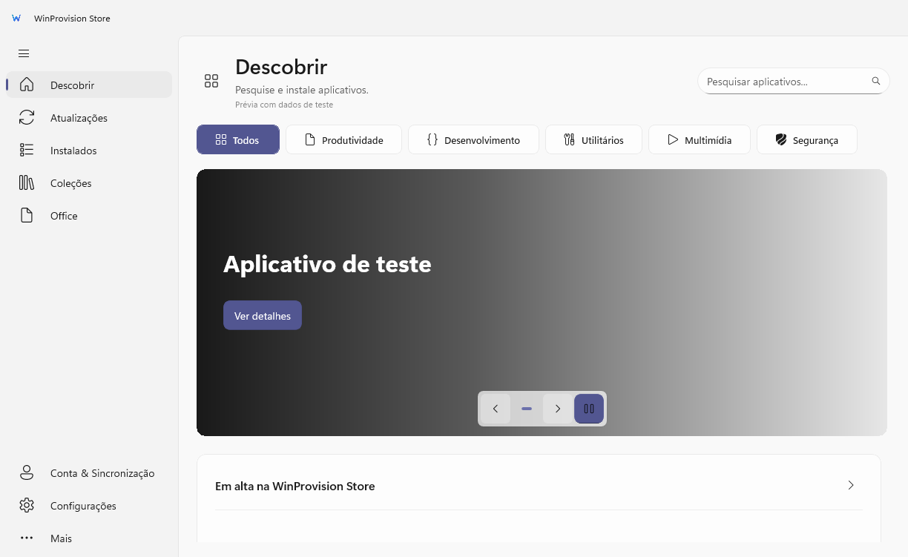
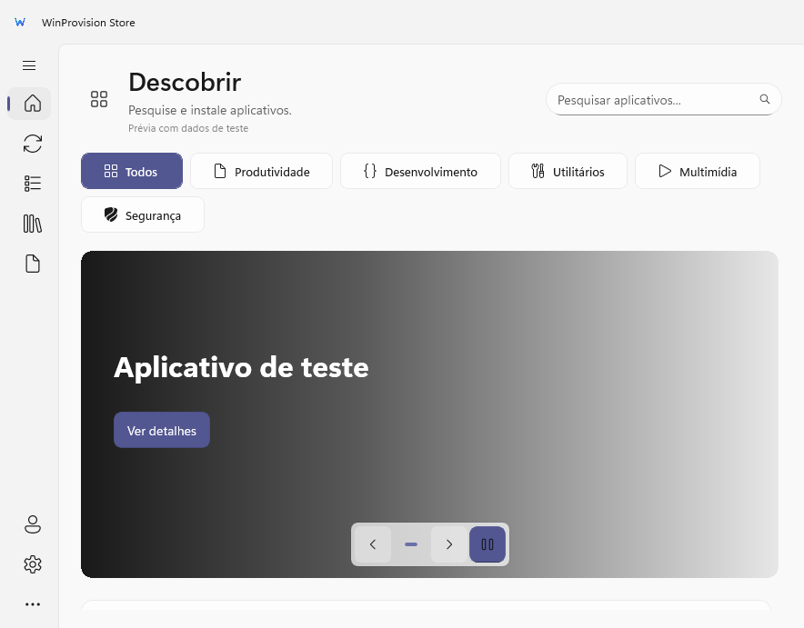

# Capturas de tela

Capturas do WinProvision Store geradas em 14 de outubro de 2026 pelo teste visual automatizado, com dados de teste. Os aplicativos, versões e estados apresentados são exemplos; as imagens não comprovam instalações reais.

## Tela inicial — tema escuro

## Tela inicial — tema claro

## Atualizações

## Coleções

## Office

## Janela compacta

## Atualizar as capturas

Execute `scripts/smoke-test.ps1` na raiz do projeto e confira as imagens geradas em `artifacts/validation/smoke`. Copie somente as capturas revisadas para `docs/screenshots`, mantendo os nomes usados nesta página e no README. As saídas completas do teste permanecem em `artifacts`.
