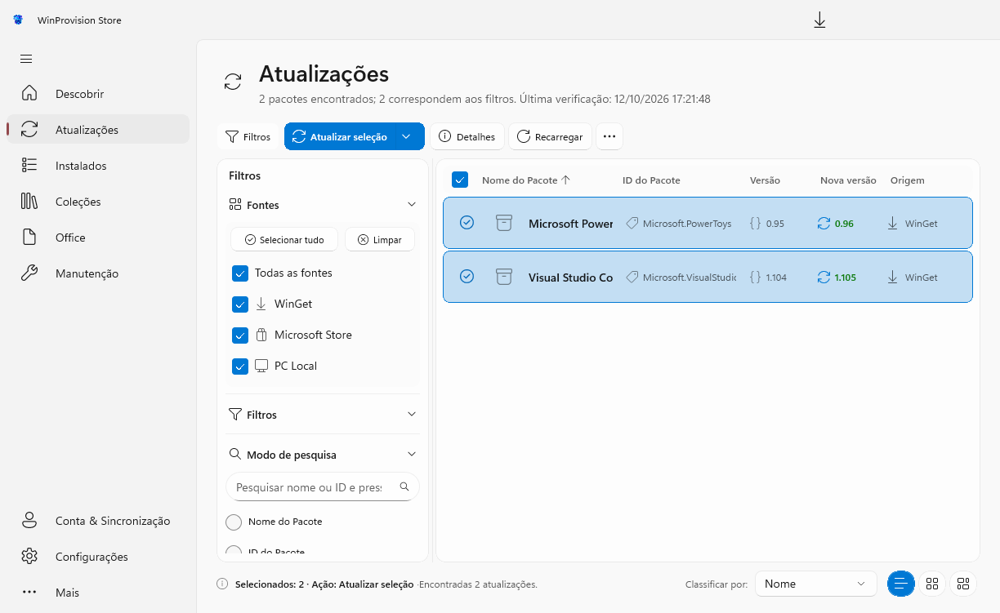
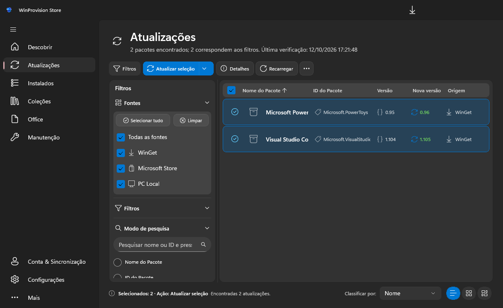

# Padronização visual — WinProvision Store

**Atualizações é a página de referência visual do projeto.** Novas páginas e refinamentos devem seguir sua composição, medidas, hierarquia e comportamento dos controles, adaptando o conteúdo à função de cada tela.

O padrão utiliza Fluent UI System Icons através de FluentIcons.WinUI, fundo Mica na janela, superfícies de tema do sistema, pesquisa arredondada e botões de visualização arredondados.

## Referência e arquivos

| Arquivo | Responsabilidade |
| --- | --- |
| [UpdatesPage.xaml](../src/WinProvision.Store/Views/UpdatesPage.xaml) | Composição de referência, templates, toolbar, filtros, tabela e overlays |
| [Updates.xaml](../src/WinProvision.Store/Styles/Updates.xaml) | Pesquisa, visualização, botão dividido, estados vazios, expansores e status |
| [Storefront.xaml](../src/WinProvision.Store/Styles/Storefront.xaml) | Medidas compartilhadas, tipografia, cabeçalho, cartões e rodapé |
| [Shell.xaml](../src/WinProvision.Store/Styles/Shell.xaml) | Recursos comuns de superfície, ação principal e ícones da navegação |
| [MainWindow.xaml](../src/WinProvision.Store/MainWindow.xaml) | Mica, barra de título e navegação |
| [App.xaml](../src/WinProvision.Store/App.xaml) | Registro dos dicionários de recursos compartilhados |
| [DESIGN.md](../DESIGN.md) | Diretrizes gerais de apresentação |

Os nomes `UpdatesSearchTextBoxStyle`, `UpdatesViewModeToggleStyle` e `UpdatesPrimarySplitButtonStyle` já são reutilizados por outras telas. Reutilize-os sem duplicar seus templates. Se forem renomeados para nomes gerais, atualize todos os consumidores na mesma alteração.

### Referências visuais

Capturas de Atualizações com dados de teste:





As capturas usam o fallback sólido do Mica: `RenderTargetBitmap` não registra o material do compositor. Na janela real, o fundo é gerenciado pelo WinUI/sistema.

## 1. Composição da página

Use quatro faixas, nesta ordem:

1. Cabeçalho com ícone, título e subtítulo.
2. Barra de ações.
3. Conteúdo principal, com filtros laterais quando necessários.
4. Rodapé com seleção/status à esquerda e ordenação/visualização à direita.

| Elemento | Medida da referência | Recurso ou aplicação |
| --- | --- | --- |
| Margem externa | `24,20,24,20` | `PageContentMargin` |
| Largura máxima | `1600` | `PageContentMaxWidth` |
| Espaço abaixo do cabeçalho | `20` | `PageHeaderMargin` |
| Área do ícone do cabeçalho | `40 × 40` | `PageHeaderIconTileStyle` |
| Espaço entre ícone e título | `12` | Margem do tile |
| Altura da toolbar | `34` | Botões e ação principal |
| Espaço abaixo da toolbar | `10` | `PageToolbarContainerStyle` |
| Largura inicial dos filtros | `260` | Coluna lateral |
| Espaço/divisor entre painéis | `8` | Coluna separadora |
| Padding do painel de filtros | `10` | Border lateral |
| Padding do painel de resultados | `8,8,8,6` | Border de conteúdo |
| Altura do rodapé | `32` | `PageStatusBarStyle` |
| Espaço acima do rodapé | `10` | `PageStatusBarStyle` |

As medidas são unidades de layout XAML, independentes do DPI. Prefira os recursos compartilhados às medidas repetidas diretamente nas páginas.

```xml
<Grid Margin="{StaticResource PageContentMargin}"
      MaxWidth="{StaticResource PageContentMaxWidth}">
    <Grid.RowDefinitions>
        <RowDefinition Height="Auto" />
        <RowDefinition Height="Auto" />
        <RowDefinition Height="*" />
        <RowDefinition Height="Auto" />
    </Grid.RowDefinitions>
    <!-- Cabeçalho, ações, conteúdo e rodapé. -->
</Grid>
```

Descobrir pode manter banners e estantes; Office pode manter sua seleção de produtos; Detalhes pode manter suas duas colunas. Compartilhe os componentes e a hierarquia visual sem impor a tabela de Atualizações a essas telas.

## 2. Tipografia

| Uso | Padrão |
| --- | --- |
| Corpo da página | `StoreFontFamily`, tamanho `13` |
| Título da página | `FluentPageTitleStyle`, tamanho `28`, `SemiBold` |
| Subtítulo | `FluentPageSubtitleStyle`, tamanho `14`, cor secundária |
| Títulos de grupos | Tamanho `13` ou `14`, `SemiBold` |
| Nome do aplicativo na tabela | Tamanho `14`, `SemiBold` |
| Metadados e cabeçalho da tabela | Tamanho `12` |
| Texto da toolbar | Tamanho `12` |
| Texto de status | `PageStatusTextStyle`, tamanho `12` |

Use `TextFillColorPrimaryBrush`, `TextFillColorSecondaryBrush` e `TextFillColorTertiaryBrush` conforme a importância da informação. Nomes e metadados longos devem usar `CharacterEllipsis`; disponibilize o texto completo em tooltip. Permita quebra de linha em descrições, mensagens e instruções de diálogos.

## 3. Fundos, bordas e cores

A janela utiliza `MicaBackdrop` com `Kind="Base"`. A raiz, a barra de título e a navegação permanecem transparentes para permitir a composição do material.

| Uso | Recurso nativo |
| --- | --- |
| Fundo opaco de diálogo/painel flutuante | `SolidBackgroundFillColorBaseBrush` |
| Camada de conteúdo | `LayerFillColorDefaultBrush` |
| Superfície elevada opaca | `LayerFillColorAltBrush` |
| Cartão | `CardBackgroundFillColorDefaultBrush` |
| Borda de cartão | `CardStrokeColorDefaultBrush` |
| Fundo normal de controle | `ControlFillColorDefaultBrush` |
| Fundo secundário/interação | `ControlFillColorSecondaryBrush` |
| Borda de controle | `ControlStrokeColorDefaultBrush` |
| Separador | `DividerStrokeColorDefaultBrush` |

Use `ThemeResource` para esses recursos. Ao criar um alias com `SolidColorBrush`, sua propriedade `Color` deve apontar ao recurso de **cor**, sem o sufixo `Brush`, como `CardBackgroundFillColorDefault`.

A ação principal e os modos de visualização selecionados usam `AccentFillColorDefaultBrush` e `TextOnAccentFillColorPrimaryBrush`. A seleção de pacotes utiliza borda na cor de destaque e preenchimento suave derivado de `SystemAccentColor`. As cores de ação e as superfícies neutras acompanham o Windows e o tema atual.

Use recursos de tema em novos controles e preserve os recursos nativos compartilhados. Mantenha os brushes como entradas por `ThemeResource`, como em [InstalledSelection.cs](../src/WinProvision.Store/Controls/InstalledSelection.cs).

## 4. Arredondamento

| Componente | Raio |
| --- | --- |
| Botões e controles comuns | `8` — `ControlCornerRadius` |
| Painéis e cartões | `12` — `StoreCardCornerRadius` |
| Botões inferiores de visualização | `14` — `UpdatesViewModeCornerRadius` |
| Barra de pesquisa | `18` — `UpdatesSearchCornerRadius` |
| Overlay de Detalhes | `16` — `AppOverlayCornerRadius` |

Templates devem propagar `CornerRadius` com `TemplateBinding`. Definir o raio apenas no controle não altera um template que usa outro valor fixo.

Preserve o tamanho e o formato internos dos checkboxes nativos. O raio `8` usado nos botões não deve transformar o indicador de checkbox em um círculo. Se necessário, limite o recurso `ControlCornerRadius` ao escopo do checkbox e use o tamanho nativo do indicador, sem recortá-lo para caber no cabeçalho.

## 5. Ícones

Use `FluentIcon` do pacote `FluentIcons.WinUI` nos ícones funcionais da interface. Use a variante `Color` somente quando o nome e o tamanho do ícone estiverem publicados na lista oficial [Fluent UI System Icons — Color](https://github.com/microsoft/fluentui-system-icons/blob/main/icons_color.md); nos demais casos, use `Regular`. Vincule ícones dinâmicos pelo enum `FluentIcons.Common.Icon`, sem códigos PUA ou `SymbolIcon`. A família `Seagull Fluent Icons` do pacote é aplicada a controles nativos que ainda criem `FontIcon` internamente. Não use outras fontes de ícones.

| Uso | Tamanho habitual |
| --- | --- |
| Navegação e ações da janela | `20`, usando os estilos de Shell |
| Cabeçalho da página | `24`, dentro do tile `40 × 40` |
| Ações e filtros | `16` |
| Mais ações | `18` |
| Metadados | `14–16`, com espaço próprio na coluna |
| Ordenação | `11–12` |

| Significado | Nome em `FluentIcons.Common.Icon` |
| --- | --- |
| Aplicativo sem imagem | `Apps` |
| Lista | `TextBulletList` |
| Cartões | `Grid` |
| Pesquisa | `Search` |
| Filtros | `Filter` |
| Recarregar | `ArrowClockwise` |
| Atualizar | `ArrowSync` |
| Detalhes | `Info` |

Utilize apenas ícones Fluent UI nas páginas padronizadas. Aplique `Color` aos ícones funcionais com variante oficial colorida, especialmente navegação, categorias e cabeçalhos; use `Regular` nos controles compactos sem versão colorida. Use imagens separadas somente para as marcas e ícones reais dos aplicativos do catálogo.

Para um ícone de ação de `16`, prefira `FluentIcon IconSize="Size16"`. Um desenho de `20` pode ficar recortado se receber uma caixa de `16 × 16`.

As imagens reais dos aplicativos permanecem imagens. O fallback deve ser Package; a URI do bitmap genérico herdado deve passar por `UpdatePackageIconUrlConverter` para que o ícone nativo seja exibido. Preserve `Stretch="Uniform"`, centralização e uma área fixa para o ícone.

## 6. Barra de ações

A sequência visível da referência é **Filtros → ação principal com variantes → Detalhes → Recarregar → Mais ações**.

- Use altura `34`, ícones de `16` e textos de `12`, alinhados verticalmente ao centro.
- Os botões comuns da referência têm padding `10,0` e margem direita `4`; filtros e ação principal usam margem direita `6`.
- Use `UpdatesPrimarySplitButtonStyle` para a ação principal com variantes e preserve as partes do template nativo do `SplitButton`.
- Coloque ações secundárias e avançadas no menu de overflow, seguindo a ordem funcional da página.
- Em largura limitada, permita rolagem horizontal da toolbar; os botões não devem se sobrepor.
- Ao habilitar/desabilitar a ação principal, confira seus estados `Normal` e `Disabled`; o destaque deve voltar corretamente quando houver uma seleção válida.

O botão Filtros indica se o painel está aberto. Um filtro adicional ativo pode destacar sua borda. Estar aberto, por si só, não transforma o botão em uma segunda ação principal preenchida de azul.

## 7. Filtros e pesquisa

Organize os filtros em grupos de expansores: **Fontes**, **Filtros** e **Modo de pesquisa**. Fontes e pesquisa iniciam expandidos; filtros adicionais podem iniciar recolhidos. Reutilize o padrão `UpdatesExpanderStyle`.

No grupo de fontes, use checkboxes nativos com tamanho padrão, raio interno 4 e cores de tema/cor de destaque do Windows, sem overrides de azul fixo. Mantenha os botões **Selecionar tudo** e **Limpar**, a opção **Todas as fontes** e as fontes individuais com ícone e rótulo. As fontes exibidas dependem do inventário da página.

Atualizações, Instalados e Coleções compartilham o estilo `PageFilterSearchBoxStyle`. A pesquisa usa altura `36`, raio `18`, texto à esquerda e padding interno `12,0,8,0`. Configure tanto o `AutoSuggestBox` quanto o `TextBoxStyle` interno:

```xml
<AutoSuggestBox Height="36"
                CornerRadius="{StaticResource UpdatesSearchCornerRadius}"
                TextBoxStyle="{StaticResource UpdatesSearchTextBoxStyle}"
                HorizontalContentAlignment="Stretch"
                VerticalContentAlignment="Center"
                PlaceholderText="Pesquisar nome ou ID e pressionar Enter..."
                AutomationProperties.Name="Pesquisar aplicativos">
    <AutoSuggestBox.QueryIcon>
        <ic:FluentIcon Icon="Search" IconVariant="Regular" IconSize="Size16" />
    </AutoSuggestBox.QueryIcon>
</AutoSuggestBox>
```

O filtro aplicado, o contador e a lista devem representar o mesmo conjunto. Uma mudança de seleção não deve apagar o texto de pesquisa. Preserve a forma de aplicação escolhida pela página — ao digitar ou ao pressionar Enter — e use um placeholder que explique esse comportamento.

## 8. Tabela, cartões e ícones

| Componente | Medida da referência |
| --- | --- |
| Cabeçalho da tabela | Altura `34`; margem inferior `4` |
| Primeira coluna de seleção | Largura `42` |
| Colunas de Atualizações | `42 / 2.2* / 2.0* / 1.1* / 1.1* / 1.3*` |
| Linha | Altura mínima `64`; padding `8,6` |
| Cartão | `214 × 248`; padding `14`; margem `0,0,16,16` |
| Tile de ícone | `120 × 140`; padding `8`; margem `0,0,8,8` |

Use as mesmas proporções de colunas no cabeçalho e no template da linha. Acrescente ou remova colunas conforme a função da tela: Instalados, por exemplo, não precisa de uma coluna de nova versão.

O clique na linha/cartão alterna a seleção, com indicador de check e preenchimento suave. Mantenha o checkbox mestre no cabeçalho; evite repetir checkbox e indicador de check no mesmo item. A seleção deve acompanhar o pacote ao trocar de modo, filtro ou ordenação.

Exiba somente a seta da coluna ordenada e atualize sua direção. Reserve largura para ícones e limite a largura dos textos de metadados, evitando que nomes longos invadam outras colunas.

Em `ListView`/`GridView`, confira os containers: padding, margem e seleção padrão não devem acrescentar outro realce ou espaço ao template do aplicativo. Preserve virtualização e não reserve linhas vazias para itens filtrados.

## 9. Rodapé e modos de visualização

À esquerda, use ícone de informação, resumo de seleção/ação e status. O resumo tem maior peso visual; o status usa cor secundária e elipse. À direita, mantenha **Classificar por:**, ComboBox de `150 × 32`, margem direita `12` e os três botões de visualização.

Os botões usam `34 × 32`, raio `14`, ícone de `16` e `UpdatesViewModeToggleStyle`. Apenas um modo pode permanecer selecionado.

```xml
<ToggleButton Style="{StaticResource UpdatesViewModeToggleStyle}"
              CornerRadius="{StaticResource UpdatesViewModeCornerRadius}"
              ToolTipService.ToolTip="Visualização em lista"
              AutomationProperties.Name="Visualização em lista">
    <ic:FluentIcon Icon="TextBulletList" IconVariant="Regular" IconSize="Size16" />
</ToggleButton>
```

O estado da visualização deve controlar tanto o destaque dos botões quanto a visibilidade do conteúdo. Não mantenha um botão destacado enquanto outro modo está sendo mostrado.

## 10. Estados de interação

Seleção, hover, pressionado, desabilitado e foco precisam funcionar juntos, nos dois temas.

- Em `ToggleButton`, siga os estados combinados usados pelo template de Atualizações: `Checked`, `CheckedPointerOver`, `CheckedPressed` e `CheckedDisabled` em `CommonStates`.
- Em `RadioButton`, respeite os grupos `CommonStates` e `CheckStates`. Evite que ambos controlem a mesma propriedade de fundo: esse conflito já deixou categorias selecionadas com texto branco sobre fundo claro.
- A seleção deve manter preenchimento e contraste ao entrar/sair do hover e ao pressionar o controle.
- Ao desmarcar, restaure fundo, borda e texto de forma consistente; a troca de tema deve atualizar os recursos.
- Preserve foco por teclado, rótulos de acessibilidade e atalhos apropriados ao componente.

Não copie os nomes de estados de um controle para outro sem conferir o template nativo correspondente.

No XAML, use estados visuais, `ElementName`, `x:Bind` ou `RelativeSource TemplatedParent` conforme o controle. Preserve os bindings de tema durante a mudança de estado.

## 11. Estados de página e diálogos

Use estados separados para carregamento inicial, resultados, pesquisa sem resultados e erro. Um erro de descoberta deve apresentar uma mensagem e permitir recarregar; não deve parecer uma lista vazia bem-sucedida.

Os estados vazios reutilizam `PageEmptyStatePanelStyle`, `PageEmptyStateIconTileStyle`, `PageEmptyStateTitleStyle` e `PageEmptyStateMessageStyle`. O logo pode identificar a página vazia; Package continua sendo o fallback dos aplicativos.

Nos overlays de Atualizações, as larguras de referência são `560` para ignoradas, `480` para atualização manual e `500` para opções. Use padding `24`, fundo opaco de tema e limite largura/altura ao espaço disponível. Se o conteúdo exceder a altura, role o corpo e mantenha as ações acessíveis.

Ao abrir, leve o foco para uma ação ou campo pertinente. Ao fechar, restaure o foco anterior. Escape deve fechar primeiro o elemento mais interno, como uma ampliação ou menu, antes do overlay principal.

## 12. Validação de uma página padronizada

Antes de concluir uma alteração de interface, verifique:

- Temas claro e escuro, incluindo seleção, hover, pressionado e desabilitado.
- Janela ampla e compacta, sem sobreposição de toolbar, rodapé, títulos ou modais.
- Lista, cartões e ícones com a mesma seleção e o mesmo conjunto filtrado.
- Ícones genéricos Package, imagens reais e falha de imagem.
- Textos longos, pesquisa vazia/sem resultados, carregamento e erro.
- Ordenação, seleção mestre parcial, menus e foco por teclado.
- Uso de recursos compartilhados e fundos definidos pelo tema.

```powershell
.\scripts\smoke-test.ps1
.\scripts\publish.ps1 -Validation
.\scripts\smoke-test.ps1 -PublishedDirectory .\artifacts\validation\publish\win-x64
```

O smoke test compila por padrão. Inspecione as imagens geradas em `artifacts/validation/smoke`. Valide também a publicação de testes e confira os recursos `.xbf`/`.pri` necessários.

Os testes usam serviços simulados e verificam apresentação e comportamento; não comprovam instalação, atualização ou remoção reais.

## Operações Concluídas

A fila utiliza uma superfície `Popup` com `MicaBackdrop Kind=Base`, igual ao material da janela principal. O fundo aplica uma camada da cor base do tema com 75% de opacidade sobre o Mica, mantendo texto e controles em 100%. O painel acompanha o tema e o tamanho da janela, com margem inferior/direita de 16. Cartões usam recursos de tema; alto contraste mantém fundo opaco do sistema. O diálogo de logs permanece opaco. Capturas XAML mostram o fallback de tema, pois não registram o material do compositor.

## Office

A página mantém o Mica da janela através de uma raiz transparente e cartões com recursos nativos de tema. A barra de ações usa os estilos compartilhados, ícones Fluent de 16 unidades e a cor de destaque do Windows.

A seleção de aplicativos usa CheckBox nativo dentro de cartões de tamanho uniforme. O comportamento InstalledSelection recebe brushes por ThemeResource; selecionar e desmarcar modifica o XML gerado. A ação coletiva alterna entre Selecionar todos e Desmarcar todos, respeitando aplicativos indisponíveis.

A preferência de atualizações fica em um único ToggleSwitch: vale para a próxima instalação e aplica a alteração ao Office existente, respeitando políticas organizacionais. Transições de entrada e painel usam FluentMotion e respeitam a preferência de animações do Windows. Em largura compacta, os produtos instalados passam para baixo da configuração. A prévia XML mantém botão de fechar no cabeçalho e suporte a Esc.

Os produtos do Office oferecem lista, cartões e ícones. Os botões do rodapé reutilizam UpdatesViewModeToggleStyle; a seleção mantém o mesmo estado nos três templates e utiliza o comportamento compartilhado InstalledSelection. O modo fica no OfficeViewModel e é preservado ao navegar dentro da sessão.
